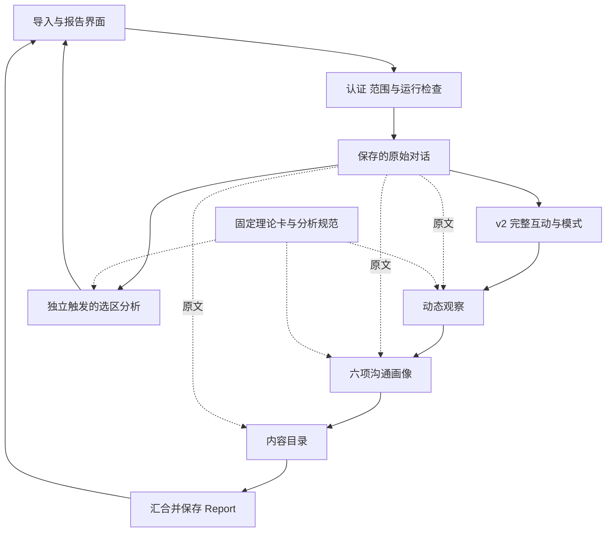
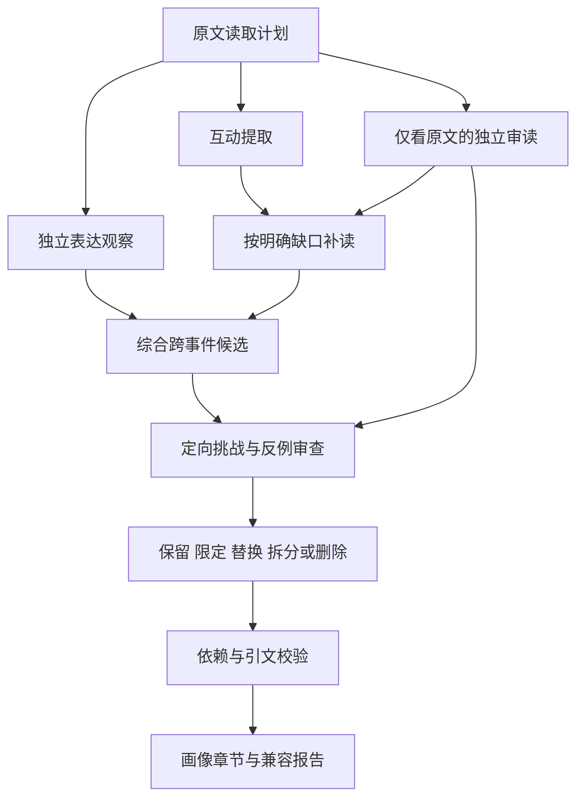

# 对话镜像的技术架构与分析流程

更新日期：2026 年 11 月 11 日。当前实现核查基于应用源码快照 `8708d32a84adc0373ea150e45a20c8dcb887a865`。本仓库发布设计文档，下文代码路径用于标明实现位置。

## 1 架构分层

系统围绕同一份原文组织多个分析任务。程序管理范围、依赖、预算、验证和保存；模型提出语义观察、形成判断、检查反例并修订正文。

| 层次 | 职责 | 当前主要组成 |
| --- | --- | --- |
| 用户体验 | 画像、目录、选区、对照、变化、原话与追问 | React 报告组件、目录与原文选择器 |
| 原文与证据 | 保存输入、标识说话者、定位引文、区分选区与背景 | Conversation、Turn、SourceRange、各模块证据对象 |
| 分析任务 | 完整互动与模式、状态变化、产品画像、目录、局部分析 | v2、dynamics、impressions、chapters、selection |
| 知识与规范 | 提供概念定义、取证步骤和复核要求 | 8 张理论卡、6 类程序规范、固定材料包 |
| 应用与保存 | 登录、数据归属、运行状态、报告与问答存储 | App Router 风格 API、Cloudflare D1、Drizzle |
| 运行与验证 | 在线模型适配、离线阶段执行、失败记录与研究验收 | StructuredModel、离线运行器、工程测试与语义诊断 |

应用采用 React 和 Next 风格的页面/API 结构，经 Vinext/Vite 运行在 Cloudflare Worker 环境。登录身份由托管环境提供，便携本地预览使用模拟身份；数据库按当前登录用户隔离查询和写入。

## 2 当前整场分析的实际编排

主链实线表示**当前请求中的执行顺序**：`analyzeV2 → analyzeDynamics → analyzeImpressions → analyzeChapters`。后续模块各自接收原文，不能把这条线理解成动态只读 v2 事件、画像只读 CSI、目录只读画像。现阶段画像、动态与选区共用新增知识包；v2 与目录使用各自的分析指令。

入口先确认登录、同源写入和对话归属。固定示例仅在原文与目标对象匹配时返回预置报告。普通对话须通过 `live` 开关检查，然后登记分析运行，防止同一对话同时产生冲突任务。各阶段状态写回数据库，最后保存汇合报告。

当前整场分析在请求内顺序执行，没有持久后台队列。引入可恢复任务、全链成本上限和选区历史，是扩大真实在线使用前的工程工作。

## 3 原文坐标与数据对象

### 3.1 一份原文 多种单位

原文保留稳定话轮 ID、说话者、文本和输入已有的时间戳。字符范围使用 UTF-16 偏移，终点不包含在选区内，便于浏览器选择、切片和后端验证使用相同坐标。

需要区分四种单位：

| 单位 | 用途 | 边界规则 |
| --- | --- | --- |
| 原始话轮与轮内范围 | 逐字定位与回看 | 由输入及字符位置确定 |
| 内容目录章节 | 帮助阅读和选择 | 一层连续覆盖原文，提供标题、简介和理由 |
| 互动事件与状态 | 理解行为及其前后关系 | 可跨章、重叠或位于同一话轮内 |
| 工程读取窗口 | 控制输入量与调度 | 按预算建立，附邻接上下文 |

原文改变后，旧目录、整理画像和选区结果需要重新核对来源身份；不能仅因对话标题相同就继续套用。选区运行使用原文哈希及规范化选区标识；目录和预置整理画像也进行来源匹配。不同模块的版本与来源字段尚未完全统一，部分指纹只承担一致性检测。

### 3.2 当前主要对象

| 对象 | 保存的关键信息 | 作用 |
| --- | --- | --- |
| Conversation / Turn | 原文、对象、话轮 ID、说话者、时间信息 | 所有分析的共同依据 |
| SourceRange / Selection | 起止话轮、轮内偏移、范围类型、多个对照范围 | 确定用户正在分析哪里 |
| 证据对象 | 指定话轮与原话；新模块另有偏移、来源类别 | 回查、逐字校验和范围验证 |
| 互动事件 | 原文锚点、行为、对方贡献、回应与后续 | 支撑局部机制和跨事件比较 |
| 候选与审查决定 | 主张、支持事件、反例、范围、处理理由 | 保留从生成到修订的过程 |
| ImpressionProfile | 综合概括、六维判断、理由与证据状态 | 提供当前范围的基础画像 |
| Dynamics | CSI 观察、状态、变化、情绪与缺口 | 表达局部过程和时间归属 |
| ChapterSet | 标题、简介、范围、边界理由与引文 | 支撑内容目录 |
| AnalysisRun / Report | 模型来源、阶段状态、缺口、报告内容 | 保存运行结果与历史 |
| KnowledgeTrace | 版本、卡 ID、选择理由与材料指纹 | 追踪本次采用的规则和资料 |

旧 v2 证据主要使用 `turnId + quote`，较新的选区、状态与画像模块增加精确位置。设计上逐步统一证据接口，同时保持历史结果可读。

## 4 完整互动与跨事件分析

v2 的任务是从一场对话中恢复有意义的互动，比较多个事件，形成可回查的解释性发现。

**读取。** 短材料默认可以全文处理；较长材料使用连续焦点窗口和有限邻接上下文，表达观察采用自己的较宽分组。当前默认短材料阈值约 30,000 字符，长材料焦点窗口约 7,500 字符，每侧带两轮；这些是可配置的工程设置。

**独立发现。** 初始独立审读只接收原文，避免被生产者已经挑出的例子限制。互动提取和表达观察分别记录动作、语境、关系及缺失信息。

**有界补读。** 模型说明需要补什么，程序根据已见锚点扩展相邻原文。当前补读每个方向最多六个未见话轮，默认模型调用预算 40 次、补读请求预算 5 个。它尚不是任意远距语义搜索。

**综合与挑战。** 综合形成跨事件候选，之后才向独立审读者揭示候选并进行定向挑战，检查支持、反例、遗漏、量词和事件独立性。程序要求模式至少有两个不同事件 ID；它们是否真是不同互动机会，仍需要语义审查。

**实质修订。** 发现反例后修改主张本身，保留触发修订的证据。修订不能追加未经审查的新支持事件；删除模式后，依赖它的画像也要处理。当前 v2 最后进行程序约束检查，没有再增加一轮修订后的独立模型语义审核。

调度记录已提交的原文范围、成功调用、预算耗尽与待补查缺口。范围提交完整意味着工程覆盖，不等于系统找到了全部重要信息。

## 5 产品画像 动态与目录

这些任务有共同的原文基础，但输出单位与审核方式各不相同。

| 模块 | 主要输出 | 当前模型流程 | 未完成时的处理 |
| --- | --- | --- | --- |
| 产品画像 | 综合判断与六项画像 | 候选 → 复核 → 必要时修订 → 再复核，最多 4 次 | 不发布未通过的画像，保留其他可用报告层 |
| 动态观察 | CSI 观察、状态、变化、情绪 | 候选 → 逐项审核 → 必要时修订，最多 3 次 | 保存被拒项与缺口，保留可用结果 |
| 内容目录 | 连续章节、标题、简介、理由 | 候选 → 复核 → 必要时修订 → 再复核，最多 4 次 | 不套用失败目录，保留手动原文选择 |
| 选区分析 | 主判断、每段画像、内容、沟通、过程和比较 | 候选 → 复核 → 必要时修订 → 再复核，最多 4 次 | 拒绝或失败不返回成功摘要 |

这里的复核是独立模型调用，但会看到候选。只有 v2 的初始独立审读对候选保持盲态。动态模块修订后执行程序检查，没有第二轮模型复核；不同模块不能统称为同一种审核流程。

### 5.1 两套六维框架

产品六维是友善亲和、专业严谨、表达主导、开放可商量、互动投入、表达基调，服务于直观画像。CSI 的六个概念是表达活跃性、精确性、言语攻击性、探询倾向、情绪性、印象操控倾向，服务于辅助行为观察。二者不互相换算，也不自动生成测评分数。

整场画像的广泛判断需要不同互动机会。证据有限时，输出可以保留明确的局部判断；没有出现某种机会时，说明没有展示哪一方面。摘要只统合已有支持的维度，不新增未经取证的特质。

### 5.2 状态和变化直接锚定原文

状态先定位原话，再映射到阅读位置。即使目录边界调整或分段失败，通过核验的状态仍可保留。同话轮中的多个动作依据唯一引文位置定序，重复短句不能唯一定位时不猜位置。

变化分别保存前态、后态、相关承接、对方作用和后续。支撑状态被改写，而依赖它的变化未获相应修订时，程序撤下该变化。只有完整、单调的数值时间戳才采用时间比例，其他情况按话轮和轮内顺序显示。

当前动态任务最多输出 12 段、72 个状态、6 条变化、10 条情绪线索。这是代表性过程分析的输出上限，不能据此计算穷尽性行为频率。

### 5.3 目录有独立的来源校验

目录要求连续覆盖、无重叠、边界引用逐字匹配。每章至少有本章原话支撑；解释衔接时可以引用紧邻前一话轮。当前章节以完整话轮组织，用户选区可以细到轮内文字。

已整理的案例目录和模型生成目录都要匹配当前原文。目录用于导航，不作为事件存在或证据可用的强制条件。

## 6 精确选区与跨段比较

选区分析读取两部分：`selectedRanges` 是被分析的实际范围，`contextRanges` 是单独标记的邻接背景。每侧背景最多 400 个 UTF-16 字符及 12 个相邻转录单元，遇到其他选区停止。背景用于理解动作，不代替选区内的本人证据。

当前 API 允许一个单点/连续范围，或 2–5 个不重叠的对照范围；界面主要引导 A、B 两段比较。总选中文本上限为 12,000 个 UTF-16 字符。

局部六维画像中，有据判断至少引用本选区内目标说话者的原话。内容与互动判断引用相应实际发言者，不能借背景补造目标人的表现。跨段主判断和比较分别需要至少两个实际选区的支持；每段画像各自保留，同时比较相同的可观察行为。两段任务不同或没有本人发言时，将这个条件写入结果。

前端在切换范围时取消旧请求，并核对响应的原文哈希与选区标识。两侧已有画像各自保留，缺少结果的一侧说明状态。新生成选区结果当前保存在页面内存，持久化历史尚未实现。

## 7 知识层与显式分析规范

知识层当前包含八张卡及六类程序规范。卡片描述概念与证据要求，规范承担共用取证、六维观察、动态过程、局部范围、跨段比较、复核修订。

一次分析入口构建一个固定材料包，生成、审核和修订复用它。模型接收规范正文；版本、选择原因和实验模式等追踪信息仅附最终产物，不进入候选复核数据。

| 模式 | 加载方式 | 用途 |
| --- | --- | --- |
| baseline | 保留原流程，不添加新增卡与共用规范 | 检验整个新增材料包的增量 |
| all | 共用规范与任务全部适用卡 | 当前有限试用默认 |
| retrieved | 相同共用规范，加任务/维度必需卡及关键词选中的专项卡 | 检验材料筛选与压缩 |

`all` 和 `baseline` 同时改变理论与程序规范，因此差异只能归因于整个材料包。`all` 和 `retrieved` 的比较才检验筛选。必要规范不会因某个关键词未出现而撤下。

当前没有向量库、嵌入服务或在线文献搜索。后续需要分别发展两条能力：理论检索在库扩大时选择适用概念；原文检索寻找当前判断所需的回应、修订、远距关联和反例。两者使用不同的质量指标。

## 8 校验 保存与失败处理

模型接口接收阶段指令、结构化数据、JSON schema 和运行时校验器。在线适配器将模型输出解析为结构化结果，对拒绝、未完成响应、格式错误、超时及服务失败分类处理，并限制重试。转录、候选和用户反馈均按待分析数据处理。

程序承担可以确定检查的事项：范围存在、引文逐字匹配、说话者归属、先后顺序、选区边界、必需字段、关系依赖、来源版本以及预算状态。语义审核承担引文含义、互动功能、解释力度、反例和遗漏判断。

数据库保存四类记录：

- 对话：原始提交和结构化话轮。
- 分析运行：阶段状态、时间、失败原因和已保存报告。
- 问答：问题与通过核验的回答。
- 反馈：用户针对结论提出的质疑，作为后续复查线索。

读写、导出和删除均受当前用户与对话归属约束。已有报告保留，反馈不直接改写历史原文或悄悄覆盖旧结论。原型模式不因环境已有凭据就自动调用模型；在线分析需显式启用 `live`。

启用在线分析后，必要转录和上下文会发送给模型服务，凭据保留在服务端配置中。公开设计文档与个人对话的保存范围分别管理；在线开放前还需完善面向用户的数据使用、保留与删除说明。

当前自由追问实现会读取原文、最新报告、有限历史与当前焦点，经过回答生成及语境核验再保存。原型仅开放匹配固定示例的预置问答，真实新材料的自由追问尚未完成线上验收。

## 9 目标架构的下一步

现有模块已经能各自读取原文、产出报告和回查证据。下一阶段的价值重点是减少漏读与重复读取，并让不同输出共享可核查的关系。

| 待发展能力 | 具体设计 | 决定是否采用的依据 |
| --- | --- | --- |
| 话题与功能表示 | 话题层级、轮内功能片段、回应/指代关系分别保存 | 能否补齐重要互动而不强制共用分段 |
| 事项状态追踪 | 同一提议的提出、确认、修改、撤回连接成链 | 能否避免把旧安排误写成最终决定 |
| 按任务补证据 | 按主张要求寻找发起、回应、后续和反例 | 必要上下文召回与最终判断质量 |
| 远距原文召回 | 词面与语义召回结合关系扩展，最终回查原文 | 相关证据召回、误召回和资源消耗 |
| 可比机会集合 | 按行为定义登记机会、支持、反例与未知 | 与人工机会清单的吻合，之后才讨论比例 |
| 可恢复运行 | 任务队列、阶段检查点、取消、失败恢复和全链预算 | 实际长任务完成率、用户等待与成本 |
| 选区持久化 | 按原文版本、范围和方法版本保存结果 | 能否可靠复用并追溯旧结果 |

目标调度方式是：先定义一项判断需要的证据，从原文或关系索引中组装材料，必要时补读，再影响相关结论。不会为每个片段、视图和维度无条件生成全部组合调用。

共享索引可能继承一次错误标注，因此仍需保留独立原文审读。复杂架构须与充分配置的全文方案比较；若效果相当而成本更高，保留简单路径。相关验收见[验证路线](validation-roadmap.md#5-下一阶段的实施顺序与决策门槛)。

## 10 实现位置索引

以下路径相对应用项目 `conversation-studio`，用于核对本稿所述实现；它们不是本公开文档仓库中的下载链接。

| 主题 | 代码位置 |
| --- | --- |
| 整场编排 | `app/api/conversations/[id]/analyze/route.ts` |
| v2 分析 | `lib/v2/engine.ts`、`lib/v2/model-stages.ts` |
| 产品画像 | `lib/impressions/engine.ts`、`lib/impressions/contracts.ts` |
| 动态与校验 | `lib/dynamics/engine.ts`、`lib/dynamics/validate.ts` |
| 目录 | `lib/chapters/engine.ts`、`lib/chapters/index.ts` |
| 选区与上下文 | `lib/selection/engine.ts`、`lib/selection/context.ts`、`lib/selection/source.ts` |
| 范围操作与显示 | `components/report-timeline.tsx`、`components/source-range-picker.tsx`、`components/report-impressions.tsx` |
| 知识装载 | `lib/analysis-knowledge.ts`、`lib/knowledge/`、`analysis-skills/procedures.ts` |
| 认证 模型与存储 | `lib/http.ts`、`lib/model.ts`、`db/schema.ts`、`lib/repository.ts` |
| 研发执行 | `scripts/run-v2-offline.mjs`、`scripts/run-observation-offline.mjs`、`scripts/run-dynamics-offline.mjs`、`scripts/run-selection-offline.mjs` |

离线运行器复用当前引擎，输出阶段请求并等待隔离真实子代理的响应，保留实现快照、哈希、请求响应和失败记录。这与工程测试中的替身调用分别计数；其目的在于诊断真实语义表现。
