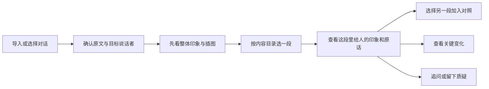
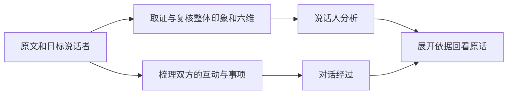

# 对话镜像的产品目标与完整方案

更新于 2026 年 11 月 18 日。

## 1 期望得到的效果

用户打开报告时，希望认出自己在这次交流里给人的印象。**跟我一起做事是什么感觉？意见不合时，跟我好商量吗？** 首屏给出一句鲜明的印象、必要的解释和已保存的插图，再让读者核对哪些话带来了这种感觉。

同一段活动筹备会议，换一个分析对象，答案也应跟着变。下表的两条人物印象由项目对照原文整理，随后一行是同场会议的进展。 [AliMeeting（阿里巴巴集团，CC BY-SA 4.0）](https://www.openslr.org/119/)

| 读者想知道什么 | 读到的结论 | 原文中的依据 |
| --- | --- | --- |
| 跟 B 共事是什么感觉？ | 有主见、肯接活，争起来有点冲。 | B 主动接下视频制作，坚决否定后放的作用，后来也接受先到现场试放。 |
| 跟 A 共事是什么感觉？ | 有自己的判断，也给执行的人留决定的余地。 | A 解释了为什么倾向后放，最后请负责制作的人比较现场效果再选顺序。 |
| 会议决定了什么？ | B 负责制作，双方同意试放，播放顺序待定。 | 在「对话经过」核对双方同意的分工与试放办法。 |

可以从措辞判断一句话听起来有点呛。要写对方当时觉得被冒犯，需要对方明确表达过这种感受。一次会谈可以支持初听时和谈开后的印象变化。长期相处如何，需要跨次交流的材料。

产品首先服务于个人回看，也适用于访谈、讨论或协作后的沟通复盘。当前以用户选定的原文及说话者为依据，判断限定在这次交流的场合。

## 2 要解决的用户问题

用户往往记得谈了什么，却不容易同时观察自己怎样说、对方怎样接、话题怎样被共同推进。常见的困惑包括：说得多是否意味着主导，配合回答是否等于友善，反驳是否意味着攻击，礼貌附和是否代表真正接受意见。

系统需要把这些容易混在一起的现象拆开，再形成连贯的判断。

| 用户问题 | 产品需要交付的结果 |
| --- | --- |
| 与我交流大致是什么感觉？ | 整体印象与已有插图，接着是从六个角度给出的短评 |
| 我怎样参与了这次交流？ | 可回查的互动发现，说明本人怎样回应、对方如何接续 |
| 我在不同话题或场景中是否一样？ | 整场与局部画像、片段之间的可解释对照 |
| 双方谈到了哪一步？ | 对话经过、已经议定的事项和仍待决定的问题 |
| 某个转折究竟发生了什么？ | 前态、相关回应、后态与后续的变化过程 |
| 你为什么这么说？ | 可以定位的本人原话、必要上下文、反例与修订理由 |
| 我可以关注什么？ | 从已成立的发现中提炼一个具体行为提醒，避免泛泛的“多倾听” |

最后一项是期望能力：当前已有具有反思价值的发现，尚未建立独立的沟通训练与建议效果验证模块。建议应随证据和用途逐步发展。

## 3 一份报告应该包含什么

### 3.1 整体印象与六维短评

首屏标题回答这位合作者或谈话对象给人什么感觉。桌面上，已有插图和文字并排。手机上，先读标题，看图，再读解释。整场阅读中，六个维度的短评可以直接扫读，理由与原话按需展开。比如专业严谨写成“听着懂行，但对效果说得太满”，其依据是 B 怎样解释观众反应，以及用了多确定的措辞。

若整体判断缺少可核对的依据或未通过复核，首屏可以呈现一项有原话支持且已通过的维度，并标明“专业严谨这一面”等范围。没有可呈现的判断时，页面说明整体印象仍待补充，读者可以继续查看已有的互动观察和原文。

| 维度 | 主要观察内容 | 短评回答的问题 |
| --- | --- | --- |
| 友善亲和 | 尊重、支持、体谅、如何回应对方顾虑 | 跟这个人说自己的顾虑，容易开口吗？ |
| 专业严谨 | 解释的具体性、条理、理由、条件与限定 | 听起来懂行吗？讲到不确定的地方有分寸吗？ |
| 表达主导 | 发起方向、重设问题、推动安排、分配表达空间 | 讨论容易被带动吗？跟得上这位说话者的节奏吗？ |
| 开放可商量 | 对不同意见、提示、纠正和条件的回应 | 意见不同时，还有多少商量余地？ |
| 互动投入 | 对具体问题和理由的承接、追问与延展 | 说出来的具体顾虑会得到回应吗？ |
| 表达基调 | 轻松、正式、克制、直接、强硬等措辞表现 | 跟这位说话者交流感觉轻松、正式、有距离，还是偶尔有点冲？ |

六项可以同时突出，彼此不互斥。专业严谨评价表达表现，不能据职业、术语或自信认证实际专业能力；友善需要面向对方的积极证据，单凭没有攻击还不足以成立。

这是本项目面向用户的观察框架。理论来源提供概念区分，六项本身尚不是经过验证的统一量表，也不输出人格分数或常模排名。来源关系见[理论附录](references.md)。

### 3.2 最有辨识度的发现

具体互动帮助解释印象如何形成。下面是运动闲聊场景的一项示意判断。

> 他会接住别人的理由，发展成自己的新观点。

聊羽毛球时，说话者接过对方说的交友好处，谈自己会选什么运动。聊篮球时，又借对方提到的三分球效率解释球员站位。这两处支撑愿意顺着别人的理由往下想的印象。羽毛球那次把对方的一项理由说成了对方最看重的好处，读者也可以回查这个边界。

概括重复做法需要多个独立、可比较的互动机会。单次回应可以说明当时的印象，正文写清场合和实际可见的后续。

### 3.3 内容与互动过程

内容层帮助用户知道讨论了哪些问题、提出过哪些理由和安排；互动层解释谁发起、谁回应、哪里出现澄清、异议或修正，以及过程怎样继续。

两层相互补充。例如“讨论了周末安排”是内容，“一方提出时间，另一方补充限制，双方修改方案”是互动。后续出现新的限制时，事项的状态也要更新。完整的事项状态索引属于下一阶段架构；当前已有内容摘要和具体互动记录。

### 3.4 局部状态与关键变化

变化报告回答“这里前后有什么不同、这一变化怎样发生”。理想的变化记录包含前态、相关承接、后态、对方回应和后续延续；若材料只有前后两个孤立点，就只比较它们的表现，不补造中间过程。

状态图以原文位置表达发起、展开、收束、修正和再次展开。没有可靠时间戳时按原文顺序展示；同一话轮也可以有多个先后动作。

情绪单独处理：区分本人自述、转录中的外显线索，以及时间归属。讲过去害怕的经历，与谈话当下紧张是两类信息。现阶段使用定性事件与区间，不生成未经校准的连续情绪数值曲线。

### 3.5 从判断返回原话

展开首屏的「哪些话给人这种感觉？」可以查看本人原话。有引文的维度可点「查看依据」，定位对应发言及其上下文。话轮与录音对齐后可回听该处。若判断使用对方明确说过的感受，可以核对对方原话与出处。

画像插图用虚构人物表达这次交流给人的印象。已有图直接显示在首屏。实时模式配置模型及媒体存储后，读者可在首屏生成一张缺失的整场图。「插图」页可以查看各报告版本的已存原图。当前报告已有整场图时，还可生成或重画分段配图。

实时模式已配置模型时，已完成的旧报告可点「生成合作印象」。新画像补在原报告上。可以展开原有六项观察，继续使用相同的报告链接和插图。

真正改变含义的条件直接写进判断，例如“在工作解释中较主动”。其他技术记录放到详情，让用户先理解结论，再检查结论。

## 4 用户怎样使用

1. **导入与确认。** 粘贴或导入 TXT、JSON，预览话轮、说话者与已有时间信息，指定分析对象。
2. **先看整场。** 先看一句合作印象和已有插图，再扫读六项短评。根据需要展开原话，或切到「对话经过」查双方谈到了哪一步。
3. **按内容进入片段。** 每个目录项展示标题、简介、范围和划分理由，例如“活动怎样安排”“回忆现场观众”。
4. **直接选择原文。** 用户可以跨页设起止，也可以在长发言中选择几句话；确认前看见实际选中的文本。
5. **比较两段。** 将第一段加入对照，再选择第二段。两侧各有自己的画像，比较结论引用两段证据。
6. **核对与追问。** 点击依据返回准确位置，查看完整过程；必要时针对某一判断发问或留下质疑。

原型模式可读完整演示和已有结果。启用实时模式并配置模型后，由用户点击分析或更新按钮启动选段分析。尚未生成印象的范围仍可阅读原文和已有观察。

## 5 为什么采用内容目录与精确选区

一条抽象时间线容易让用户混淆三件事：对话如何分段、分析发现在哪里、点选后会做什么。主入口因此采用有标题的内容目录，并在报告附近持续显示“正在查看整场还是哪一段”。

目录按正在讨论的问题和交谈任务组织，边界参考问题展开、问答衔接与话题转换。每段给出具体划分理由；一句话同时收束旧题并发起新题时，允许在解释中说明这种衔接。

目录只承担阅读导航。一个澄清或协商过程可以跨目录项，同一个片段也可以包含多个互动事件。移动合理的目录边界，不应让原本充分成立的观察无故消失。

对照的目的，是理解同一人在不同条件下怎样表达。例如讲工作逻辑时主动且具体，回忆细节时谨慎且接受提示。对象或任务不同时，先说明两处各自的表现。若要判断沟通状态发生了变化，还需要可比的证据和原文中的过渡。

## 6 分析方法的核心思路

同一份原文支持个人印象和对话经过两种阅读。

个人印象用本人的措辞和回应解释。对话经过供读者核对各方的提议、接续与双方商定的结果。 [技术架构](architecture.md)

方法上有五个关键要求：

- **以互动理解动作。** 提问、复述或反驳的作用取决于它承接什么、对方怎样回应以及后续发生什么。
- **先定义判断需要的证据。** “修订了说法”需要前后说法；“回应反馈后调整”还需要中间的反馈；“经常如此”需要可比较的机会集合。
- **同时检查支持与边界。** 反例应改变主张的范围、力度或解释，必要时替换或删除主张。
- **保留有用的判断。** 证据充分时明确表达。审核既检查过度推断，也检查只罗列动作却没有形成认识的情况。
- **把程序校验与语义核验分开。** 引文逐字出现、位置正确是基础；是否支持含义仍需读上下文。

## 7 理论材料 RAG 与分析规范

理论材料帮助系统判断“哪些表现支持这个概念”；原文取证帮助系统判断“这场谈话实际发生了什么”；分析规范规定“怎样比较、复核和修订”。三者分别承担工作。

当前已接入八张理论卡，覆盖友善与专业、轮替、共同理解、修复、情绪与基调、CSI、精确与探询、多功能片段。每张卡保存文献原意、本项目改编、必要证据、排除条件、反例与出处。共用规范显式进入生成、复核和修订调用，单独存在一个 `SKILL.md` 文件不会自动改变网站模型行为。

现阶段库很小，默认提供当前任务的全部适用卡。已有按任务、维度和关键词选择卡片的对照模式；尚未使用向量库。每次分析固定一份材料包，后续阶段复用，避免根据候选结论临时挑选有利的理论。

原文检索的后续重点，是找齐回应、修正、远距回返和相关反例。摘要可以帮助定位，最终判断仍须回到原文。是否引入向量检索，取决于它能否保住必要上下文并减少成本。[现有比较](validation-roadmap.md#3-理论卡与分析规范的诊断结果)尚不支持扩建检索库。

## 8 产品原则与主要取舍

| 取舍 | 当前选择 | 理由 |
| --- | --- | --- |
| 整体印象与具体表现 | 整体判断与已有插图居首，随后是六维短评 | 先知道和这个人共事或聊天是什么感觉，再核对哪句话带来了这种观感 |
| 判断与证据的位置 | 首屏保留原话入口，理由和引文按需展开 | 扫读后可以核对发言及其前后文 |
| 全局与局部 | 分别取证、分别生成 | 整场特征不能直接套在任意片段上 |
| 导航与分析边界 | 目录连续，事件和关系可跨段 | 兼顾可操作性与互动完整性 |
| 全文与分批 | v2 短材料可全文、较长材料有界分批；其他整场模块当前读全文 | 依据任务粒度与成本选择，不以时长直接推断全文失效 |
| 多模型调用 | 用于不同任务、审读与修订 | 收益应体现在更好的判断和更少遗漏，调用数量本身不是质量 |
| 评分与文字画像 | 先提供可解释判断 | 当前没有文本维度的常模、测量效度和概率校准 |

## 9 成功应该怎样衡量

阅读验收的第一项是只看首屏，能否说出与这位说话者共事或聊天是什么感觉。展开依据后，读者能否指出哪句话形成这种印象、这项判断适用于哪里。看完对话经过后，还应能说清双方议定了什么。

分析质量需要同时衡量主张支持、重要内容召回、上下文完整、反例处理和回答覆盖；不能靠少说或一概拒答换取较高的表面正确率。工程则保证范围、来源、失败状态与版本可靠，并记录真实资源消耗。

当前成果、证据强度与后续决策门槛统一见[验证结果与实施路线](validation-roadmap.md)。这份设计的下一步重点是完善真实新材料验收和用户可用性验证，根据验证结果改进取证与检索。
