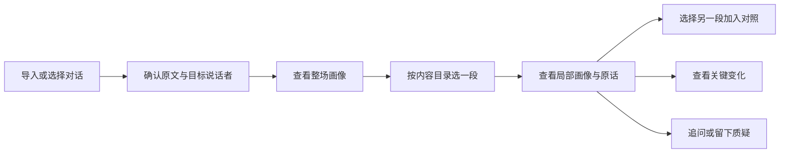
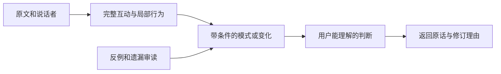

# 对话镜像的产品目标与完整方案

更新日期：2026 年 11 月 11 日。

## 1 期望得到的效果

用户提供一场与他人的对话，系统帮助他看清三个层面：**这次交流给人的沟通感受、自己具体怎样参与互动、这些表现在哪些情境下发生变化。** 用户首先看到有信息量的判断，随后能够理解判断的理由、核对原话，并比较不同片段。

一份理想结果应让用户获得这样的认识：

> 我在这次谈话里解释得具体，也愿意接用对方的理由继续展开。谈熟悉的工作时，我会主动重设问题；回忆不确定的细节时，我更谨慎，也更愿意借助对方的提示。有一处我把对方的一个理由说成了最重要的理由，这可能值得下次留意。

这是**产品效果示意**。它同时包含基础画像、情境差异和一个具体可反思的动作，每一部分都应由对应原文支撑。

产品首先服务于个人对一次交流的回看，也适用于访谈、讨论或协作后的沟通复盘。当前主要输入是文本转录，分析对象由用户指定；核心判断描述这次谈话中的表现。跨对象、跨时间的稳定画像属于后续研究。

## 2 要解决的用户问题

用户往往记得谈了什么，却不容易同时观察自己怎样说、对方怎样接、话题怎样被共同推进。常见的困惑包括：说得多是否意味着主导，配合回答是否等于友善，反驳是否意味着攻击，礼貌附和是否代表真正接受意见。

系统需要把这些容易混在一起的现象拆开，再形成连贯的判断。

| 用户问题 | 产品需要交付的结果 |
| --- | --- |
| 与我交流大致是什么感觉？ | 综合画像，以及友善、专业、主导、开放、投入、基调六项判断 |
| 我有什么比较鲜明的交流方式？ | 跨完整互动的具体发现，说明行为怎样组合、在什么条件下出现 |
| 我在不同话题或场景中是否一样？ | 整场与局部画像、片段之间的可解释对照 |
| 某个转折究竟发生了什么？ | 前态、相关回应、后态与后续的变化过程 |
| 你为什么这么说？ | 可以定位的本人原话、必要上下文、反例与修订理由 |
| 我可以关注什么？ | 从已成立的发现中提炼一个具体行为提醒，避免泛泛的“多倾听” |

最后一项是期望能力：当前已有具有反思价值的发现，尚未建立独立的沟通训练与建议效果验证模块。建议应随证据和用途逐步发展。

## 3 一份报告应该包含什么

### 3.1 综合画像与六项基础判断

首页最显眼的位置回答“这个人在当前范围内表现怎样”。综合判断用一两句话串起主要表现与必要条件，六项基础画像直接可见，每项附一句理由，并可展开原话。

| 维度 | 主要观察内容 | 有价值的判断应说明什么 |
| --- | --- | --- |
| 友善亲和 | 尊重、支持、体谅、如何回应对方顾虑 | 面向谁，具体怎样照顾或没有接住对方 |
| 专业严谨 | 解释的具体性、条理、理由、条件与限定 | 哪个解释清楚，依据与结论之间是否接得上 |
| 表达主导 | 发起方向、重设问题、推动安排、分配表达空间 | 在什么互动中主动带方向，何时跟随或让出空间 |
| 开放可商量 | 对不同意见、提示、纠正和条件的回应 | 接受了什么，调整了什么，又坚持了什么 |
| 互动投入 | 对具体问题和理由的承接、追问与延展 | 接住了哪一部分，是否沿着对方的答案继续 |
| 表达基调 | 轻松、正式、克制、直接、强硬等措辞表现 | 当前基调的原话依据，以及不同片段中的变化 |

六项可以同时突出，彼此不互斥。专业严谨评价表达表现，不能据职业、术语或自信认证实际专业能力；友善需要面向对方的积极证据，单凭没有攻击还不足以成立。

这是本项目面向用户的观察框架。理论来源提供概念区分，六项本身尚不是经过验证的统一量表，也不输出人格分数或常模排名。来源关系见[理论附录](references.md)。

### 3.2 最有辨识度的发现

六项画像回答基本问题，独特发现进一步说明这个人的参与方式。例如在运动闲聊的开发案例中，值得突出的判断是：

> 他会接住别人的理由，发展成自己的新观点。

它背后的分析应交代：对方提供了哪个比较标准，目标说话者怎样使用这个标准，随后如何转入自己的经历，对方又怎样接续。若另一处承接加强了对方原本的意思，正文也要指出这个边界。

发现的质量取决于**行为之间的联系与解释价值**。报告可以概括一个有意义的模式，但需要说明它在哪些独立互动中成立；只有一次证据时，就把局部表现说具体。

### 3.3 内容与互动过程

内容层帮助用户知道讨论了哪些问题、提出过哪些理由和安排；互动层解释谁发起、谁回应、哪里出现澄清、异议或修正，以及过程怎样继续。

两层相互补充。例如“讨论了周末安排”是内容，“一方提出时间，另一方补充限制，双方修改方案”是互动。后续出现新的限制时，事项的状态也要更新。完整的事项状态索引属于下一阶段架构；当前已有内容摘要和具体互动记录。

### 3.4 局部状态与关键变化

变化报告回答“这里前后有什么不同、这一变化怎样发生”。理想的变化记录包含前态、相关承接、后态、对方回应和后续延续；若材料只有前后两个孤立点，就只比较它们的表现，不补造中间过程。

状态图以原文位置表达发起、展开、收束、修正和再次展开。没有可靠时间戳时按原文顺序展示；同一话轮也可以有多个先后动作。

情绪单独处理：区分本人自述、转录中的外显线索，以及时间归属。讲过去害怕的经历，与谈话当下紧张是两类信息。现阶段使用定性事件与区间，不生成未经校准的连续情绪数值曲线。

### 3.5 从判断返回原话

证据应当靠近判断，但默认不占据主画面。用户点开后，先看到最关键的原话，再按需查看完整互动和相邻上下文。原话须保留说话者、位置和范围；如果结论依赖对方反馈，应能同时看到那条反馈。

真正改变含义的条件直接写进判断，例如“在工作解释中较主动”。其他技术记录放到详情，让用户先理解结论，再检查结论。

## 4 用户怎样使用

1. **导入与确认。** 粘贴或导入 TXT、JSON，预览话轮、说话者与已有时间信息，指定分析对象。
2. **先看整场。** 综合判断和六项画像建立初步认识，独特发现说明最值得注意的参与方式。
3. **按内容进入片段。** 每个目录项展示标题、简介、范围和划分理由，例如“活动怎样安排”“回忆现场观众”。
4. **直接选择原文。** 用户可以跨页设起止，也可以在长发言中选择几句话；确认前看见实际选中的文本。
5. **比较两段。** 将第一段加入对照，再选择第二段。两侧各有自己的画像，比较结论引用两段证据。
6. **核对与追问。** 点击依据返回准确位置，查看完整过程；必要时针对某一判断发问或留下质疑。

当前原型支持预置示例问答和已有离线结果；自选范围本身不会触发模型。在线模式开放后，用户明确点击生成才启动新分析。尚未生成的范围会保留原文和已有可用观察，并说明结果状态。

## 5 为什么采用内容目录与精确选区

一条抽象时间线容易让用户混淆三件事：对话如何分段、分析发现在哪里、点选后会做什么。主入口因此采用有标题的内容目录，并在报告附近持续显示“正在查看整场还是哪一段”。

目录按正在讨论的问题和交谈任务组织，边界参考问题展开、问答衔接与话题转换。每段给出具体划分理由；一句话同时收束旧题并发起新题时，允许在解释中说明这种衔接。

目录只承担阅读导航。一个澄清或协商过程可以跨目录项，同一个片段也可以包含多个互动事件。移动合理的目录边界，不应让原本充分成立的观察无故消失。

对照的目的，是理解同一人在不同条件下怎样表达。例如讲工作逻辑时主动且具体，回忆细节时谨慎且接受提示。比较时需要先看两段各自在做什么，避免把任务不同造成的表达差异直接写成能力提升或情绪变化。

## 6 分析方法的核心思路

分析围绕一条可回查的关系展开：

这张图表示**判断与证据之间应具备的关系**。当前程序包含多个分别读取原文的分析模块，实际调度见[技术架构](architecture.md)，不能把它理解成所有画像都由事件模块逐级计算得到。

方法上有五个关键要求：

- **以互动理解动作。** 提问、复述或反驳的作用取决于它承接什么、对方怎样回应以及后续发生什么。
- **先定义判断需要的证据。** “修订了说法”需要前后说法；“回应反馈后调整”还需要中间的反馈；“经常如此”需要可比较的机会集合。
- **同时检查支持与边界。** 反例应改变主张的范围、力度或解释，必要时替换或删除主张。
- **保留有用的判断。** 证据充分时明确表达。审核既检查过度推断，也检查只罗列动作却没有形成认识的情况。
- **把程序校验与语义核验分开。** 引文逐字出现、位置正确是基础；是否支持含义仍需读上下文。

## 7 理论材料 RAG 与分析规范

理论材料帮助系统判断“哪些表现支持这个概念”；原文取证帮助系统判断“这场谈话实际发生了什么”；分析规范规定“怎样比较、复核和修订”。三者分别承担工作。

当前已接入八张理论卡，覆盖友善与专业、轮替、共同理解、修复、情绪与基调、CSI、精确与探询、多功能片段。每张卡保存文献原意、本项目改编、必要证据、排除条件、反例与出处。共用规范显式进入生成、复核和修订调用，单独存在一个 `SKILL.md` 文件不会自动改变网站模型行为。

现阶段库很小，默认提供当前任务的全部适用卡。已有按任务、维度和关键词选择卡片的对照模式；尚未使用向量库。每次分析固定一份材料包，后续阶段复用，避免根据候选结论临时挑选有利的理论。

原文检索的后续重点，是找齐回应、修正、远距回返和相关反例。摘要可以帮助定位，最终判断仍须回到原文。是否引入向量检索，取决于它能否保住必要上下文并减少成本。[现有比较](validation-roadmap.md#3-理论卡与分析规范的诊断结果)尚不支持扩建检索库。

## 8 产品原则与主要取舍

| 取舍 | 当前选择 | 理由 |
| --- | --- | --- |
| 基础画像与独特发现 | 两者都保留 | 用户既要知道总体感受，也要获得对自己有辨识度的认识 |
| 判断与证据的位置 | 判断优先，证据按需展开 | 减少阅读负担，同时保持核查入口 |
| 全局与局部 | 分别取证、分别生成 | 整场特征不能直接套在任意片段上 |
| 导航与分析边界 | 目录连续，事件和关系可跨段 | 兼顾可操作性与互动完整性 |
| 全文与分批 | v2 短材料可全文、较长材料有界分批；其他整场模块当前读全文 | 依据任务粒度与成本选择，不以时长直接推断全文失效 |
| 多模型调用 | 用于不同任务、审读与修订 | 收益应体现在更好的判断和更少遗漏，调用数量本身不是质量 |
| 评分与文字画像 | 先提供可解释判断 | 当前没有文本维度的常模、测量效度和概率校准 |

## 9 成功应该怎样衡量

产品成功首先表现为：用户能快速说出系统最重要的一项判断，知道它适用于哪里，并能找到关键原话。进一步要验证，这些认识是否帮助用户发现有价值的差异，而不是只产生“听起来像我”的感受。

分析质量需要同时衡量主张支持、重要内容召回、上下文完整、反例处理和回答覆盖；不能靠少说或一概拒答换取较高的表面正确率。工程则保证范围、来源、失败状态与版本可靠，并记录真实资源消耗。

当前成果、证据强度与后续决策门槛统一见[验证结果与实施路线](validation-roadmap.md)。这份设计的下一步重点是完善真实新材料验收和用户可用性验证，再依据结果开放在线分析、改进取证与检索。
